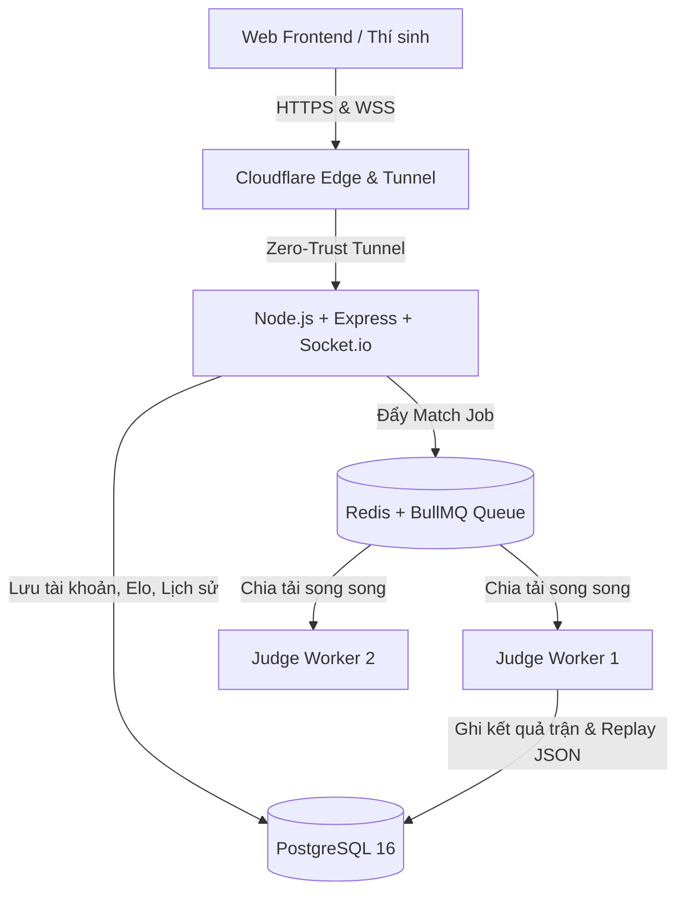

# ⚔️ Nền Tảng Đấu Trường Bot AI Kéo - Búa - Bao (Tactical RPS Arena)

Hệ thống thi đấu và chấm code Bot AI tự động thời gian thực phục vụ cho trường học, câu lạc bộ lập trình và các giải đấu cờ chiến thuật quy mô lớn (hỗ trợ trên 1.000 thí sinh).

---

## 🏛️ Kiến Trúc Hệ Thống



### 1. Công nghệ cốt lõi
- **Hạ tầng 24/7**: Docker & Docker Compose với `restart: unless-stopped` và Named Persistent Volumes cho Postgres (`postgres_data`) và Redis (`redis_data`).
- **Mạng Cloudflare Tunnel (`cloudflared`)**: Hỗ trợ chơi online mà không cần mở cổng modem (NAT/Port Forwarding), tích hợp cơ chế **Keepalive Heartbeat 15s** của WebSockets (Socket.io) chống ngắt kết nối bởi timeout của Cloudflare.
- **Backend**: Node.js + Express, Prisma ORM, PostgreSQL connection pool, JWT Authentication (bcrypt + jsonwebtoken + zod).
- **Hàng đợi & Phân tán**: Redis 7 + BullMQ Queue (`match-queue`) cho phép mở rộng không giới hạn số lượng container `judge-worker` để chấm hàng ngàn trận đấu cùng lúc.
- **Frontend**: Giao diện bàn cờ chiến thuật tương tác 8x8 / 9x9, Dark Mode chuẩn Gaming, cập nhật trực tiếp theo thời gian thực.

---

## 📁 Cấu Trúc Thư Mục

```text
Battle_Code_Code_2/
├── docker-compose.yml          # Cấu hình 5 dịch vụ: postgres, redis, backend, judge-worker, cloudflared
├── .env.example                # Biến môi trường mẫu cho hạ tầng
├── .gitignore
├── backend/
│   ├── Dockerfile
│   ├── package.json
│   ├── init.sql                # SQL khởi tạo bảng, khóa ngoại, index và map mẫu
│   ├── prisma/
│   │   └── schema.prisma       # Prisma schema chuẩn với Users, Bots, Maps, Tournaments, Matches
│   └── src/
│       ├── config/
│       │   ├── db.js           # Quản lý kết nối PostgreSQL & Prisma
│       │   └── redis.js        # Cấu hình Redis & BullMQ matchQueue
│       ├── auth/
│       │   ├── auth.validation.js # Zod validation schema
│       │   ├── auth.service.js    # Logic hash bcrypt, đăng ký, đăng nhập, JWT
│       │   ├── auth.middleware.js # Guard xác thực Bearer token & RBAC
│       │   ├── auth.controller.js # Controller xử lý HTTP request
│       │   └── auth.routes.js     # Router POST /register, POST /login, GET /me
│       └── server.js           # Server Express + Socket.io Heartbeat 15s
├── judge-worker/
│   ├── Dockerfile
│   ├── package.json
│   └── src/
│       ├── engine/
│       │   └── rpsEngine.js    # Bộ não luật cờ Kéo - Búa - Bao, xử lý va chạm & bắt cờ
│       └── index.js            # Worker BullMQ, tính Elo K-32 và ghi nhận Replay
├── frontend/
│   ├── package.json
│   ├── index.html              # Giao diện thi đấu & đăng nhập
│   └── src/
│       ├── main.js             # Logic bàn cờ, kết nối API backend & WebSockets
│       └── style.css           # Giao diện Cyberpunk Dark Mode
└── sample-bots/
    ├── python/random_bot.py    # Bot mẫu Python giao tiếp qua STDIN/STDOUT
    ├── javascript/tactical_bot.js # Bot mẫu JS phân tích thế cờ
    └── README.md               # Hướng dẫn thí sinh nộp Bot
```

---

## 🚀 Hướng Dẫn Vận Hành

### Cách 1: Khởi động toàn bộ qua Docker (Khuyên Dùng)

1. Tạo file `.env` từ file mẫu:
   ```bash
   cp .env.example .env
   ```
2. Nếu bạn có token Cloudflare Tunnel, dán vào biến `CLOUDFLARE_TUNNEL_TOKEN` trong `.env`.
3. Khởi chạy toàn bộ hệ thống:
   ```bash
   docker-compose up -d --build
   ```
4. Kiểm tra trạng thái các container:
   ```bash
   docker-compose ps
   ```

### Cách 2: Chạy trực tiếp trên máy phát triển (Local Development)

#### 1. Backend:
```bash
cd backend
npm install
npm run dev
```

#### 2. Judge Worker:
```bash
cd judge-worker
npm install
npm run dev
```

#### 3. Frontend:
```bash
cd frontend
npm install
npm run dev
```

---

## 🔐 Đặc Tả API Xác Thực (JWT Authentication)

### 1. Đăng ký tài khoản (`POST /api/auth/register`)
- **Body**:
  ```json
  {
    "username": "student_pro_01",
    "password": "mypassword123",
    "role": "STUDENT"
  }
  ```
- **Response (201 Created)**:
  ```json
  {
    "success": true,
    "message": "Đăng ký tài khoản thành công!",
    "data": {
      "user": {
        "id": "uuid-...",
        "username": "student_pro_01",
        "role": "STUDENT",
        "elo_rating": 1200,
        "created_at": "2026-10-18T..."
      },
      "token": "eyJhbGciOiJIUzI1NiIsInR5..."
    }
  }
  ```

### 2. Đăng nhập (`POST /api/auth/login`)
- **Body**:
  ```json
  {
    "username": "student_pro_01",
    "password": "mypassword123"
  }
  ```

### 3. Thông tin tài khoản hiện tại (`GET /api/auth/me`)
- **Headers**: `Authorization: Bearer <token>`
- **Response**: Trả về thông tin chi tiết, hệ số Elo và số trận thắng/thua.
